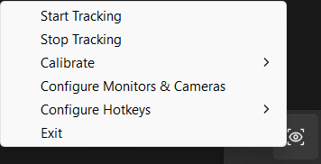
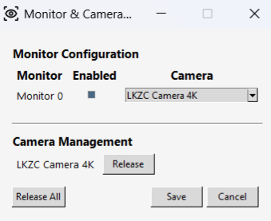

# GazeControl

Eye-tracking software for gaze-based window focusing and hands-free desktop interaction.

> Currently tested on Windows and Linux.
>
> Camera processing, calibration models, and configuration data remain local to your machine.

## Overview

GazeControl is an eye-tracking input method that lets you control your computer with your gaze. It detects where you’re looking on the screen and automatically focuses the corresponding window. This is particularly useful for:

- Users with mobility limitations who benefit from hands-free control
- Multi-window workflows where you frequently switch between applications
- Accessibility enhancement for standard computer use
- Research and accessibility applications

The system combines advanced eye-tracking algorithms with adaptive learning to provide a personalised experience that improves over time based on your natural gaze behaviour.

## Screenshots

### Tray Menu



### Monitor & Camera Configuration



## Features

### Core Functionality
- **Real-time Gaze Tracking**: Continuous eye-movement detection using webcam video
- **EyeTrax-Powered Gaze Estimation**: Built on EyeTrax for webcam-based gaze tracking and calibration
- **Automatic Window Focusing**: Smart window focus based on gaze position
- **Multi-camera Support**: Works with various USB cameras and built-in webcams
- **Per-Monitor Calibration**: Each monitor maintains its own calibration model and camera assignment
- **Cross-platform**: Runs on Windows and Linux

### Intelligent Control
- **Adaptive Dwell Learning**: The system automatically adjusts dwell time based on your behaviour:
  - Increases dwell time when you accidentally trigger focus too early (regret feedback)
  - Decreases dwell time as you successfully hold focus on intended windows (success feedback)
  - Ranges from 0.2s to 1.2s, converging to your optimal threshold

- **Manual Override Hotkey**: Bypass timing checks to immediately focus the current gaze target
- **Window Cycling**: Forward and backward navigation through overlapping windows at the same gaze position
- **Typing Detection**: Automatically disables gaze focus during typing to prevent interference
- **Hotkey Customization**: Configure hotkeys for all features via the system tray menu

### User Interface
- **System Tray Integration**: Lightweight menu-bar icon for quick access to all controls
- **Easy Calibration**: Simple calibration process for accurate eye tracking setup
- **Monitor and Camera Configuration**: Enable or disable tracking per monitor and assign cameras to each display
- **Real-time Feedback**: Visual indicators during calibration and events
- **Release Camera**: Frees the camera, allowing other applications to use it. Available from the system tray when tracking is paused and the camera is in use.

## Installation

### Quick Start (Windows)

If you have a compiled executable, simply run `GazeControl.exe`.

### From Source

#### Windows

1. **Clone the repository**:
   ```bash
   git clone https://github.com/maciejrytlewski/GazeControl.git
   cd GazeControl
   ```

2. **Create a virtual environment** (recommended):
   ```bash
   python -m venv venv
   venv\Scripts\activate
   ```

3. **Install Python dependencies**:
   ```bash
   pip install -r requirements.txt
   ```

4. **Run the application**:
   ```bash
   python main.py
   ```

#### Linux (Ubuntu/Debian)

1. **Install system dependencies**:
   ```bash
   sudo apt update
   sudo apt install -y \
      python3 python3-venv \
      python3-opencv \
      python3-gi \
      python3-pystray \
      libayatana-appindicator3-1
   ```

2. **Clone the repository**:
   ```bash
   git clone https://github.com/maciejrytlewski/GazeControl.git
   cd GazeControl
   ```

3. **Create a virtual environment (with system packages)**:
   ```bash
   python -m venv --system-site-packages venv
   source venv/bin/activate
   ```

4. **Install Python dependencies**:
   ```bash
   pip install -r requirements.txt
   ```

5. **Remove conflicting OpenCV packages**:
   ```bash
   pip uninstall -y opencv-python opencv-contrib-python
   ```

6. **Run the application**:
   ```bash
   python main.py
   ```

The application icon should appear in your system tray.

### Building a Standalone Executable

To create a standalone executable (Windows):

```bash
pip install pyinstaller
make build
```

The executable will be in the `dist/` directory.

## Getting Started

### First Launch

1. **Start the application**: Run the executable or `python main.py`
2. **Locate the tray icon**: It appears in your system tray (bottom-right on Windows, top-right on Linux)
3. **Right-click the icon**

### Initial Setup Checklist

- Open **Configure Monitors && Cameras**
- Verify each monitor is enabled or disabled as desired
- Select the correct camera for each enabled monitor
- Run calibration from **Calibrate**
- Adjust hotkeys if desired
- Start tracking from **Start Tracking**

## Configuration

### Calibration

Calibration is essential for accurate gaze tracking. The system learns the relationship between your eye appearance and screen position.

#### How to Calibrate

1. Open the system tray menu
2. Click "Calibrate"
3. A calibration window will appear with reference points
4. Follow the on-screen instructions:
   - Look at each marker carefully
   - Keep your head relatively still
   - Try to look at the center of each target point
   - The calibration typically takes 1-2 minutes
5. Once complete, the model is saved for future sessions

#### Tips for Successful Calibration

- **Lighting**: Ensure good lighting on your face
- **Distance**: Sit at your normal working distance (typically 50-70cm from screen)
- **Head Position**: Keep your head in a natural, comfortable position
- **Eye Openness**: Make sure your eyes are fully open and visible
- **Glasses/Contacts**: Wear the same glasses/contacts you'll use while working
- **No Movement**: Minimise head movement during calibration
- **Multiple Calibrations**: If tracking accuracy drops, recalibrate (different conditions or lighting can affect performance)

#### Recalibration

If tracking accuracy degrades after extended use, recalibrate:
- Conditions change (lighting, camera position, glasses changed)
- System shows poor focus timing
- Different users are using the system

### Hotkeys

#### Viewing Current Hotkeys

Open the system tray menu → "Configure Hotkeys" to see current bindings.

#### Changing Hotkeys

1. Open system tray menu
2. Select "Configure Hotkeys"
3. Click the hotkey you want to change
4. A dialog will appear prompting you to press the new key combination
5. Press your desired key combination, key by key
6. The hotkey is saved immediately

#### Supported Key Combinations

- Single keys: `a`, `b`, `1`, `2`, etc.
- Modifiers: `<ctrl>`, `<alt>`, `<shift>`, `<cmd>`
- Special keys: Press and the system will recognize most common keys
- Examples:
  - `<alt>+\`
  - `<ctrl>+<shift>+f`

### Monitor and Camera Configuration

To configure which camera is used for each monitor:

1. Open the system tray menu
2. Select **Configure Monitors && Cameras**
3. Enable or disable tracking per monitor
4. Choose the camera assigned to each monitor
5. Click **Save**

If you change camera position, monitor layout, or lighting conditions, recalibration is recommended.

You can also release cameras from this window while tracking is stopped, allowing other applications to use them.

### Adaptive Dwell Learning

GazeControl automatically adjusts dwell time based on your behaviour.

- If focus triggers too aggressively, dwell time increases.
- If focus feels too slow, dwell time decreases.
- Dwell time adapts over time to match your usage patterns.

#### Monitoring Dwell Adaptation

The current dwell time is stored in your configuration file. To view it, you can check the config file in:
- **Windows**: `%LOCALAPPDATA%\GazeControl\config.json`
- **Linux**: `~/.local/share/GazeControl/config.json`

#### Manual Dwell Adjustment

If you want to start with a different initial dwell time:

1. Locate your config file (see paths above)
2. Edit `config.json` and add/modify:
   ```json
   {
     "adaptive_dwell": 0.6
   }
   ```
3. Restart the application

Valid range: 0.2 (fast) to 1.2 (slow) seconds

## Usage Guide

### Basic Workflow

1. **Start Tracking**: Open tray menu → "Start Tracking"
   - Tray icon menu should show live eye tracking
   - Status updates in real-time

2. **Look at a Window**: Gaze at the window you want to focus
   - Wait for dwell time to elapse (typically 0.5s initially)
   - Window automatically comes to focus

3. **Type Normally**: Typing detection prevents accidental refocus
   - Focus stays on your current window while typing
   - Normal typing productivity flow maintained

4. **Switch Windows**:
   - **Automatic**: Look at another window, wait for dwell
   - **Manual Override**: Use Alt+\ hotkey to focus instantly
   - **Cycle**: Use Alt+] or Alt+[ to cycle between overlapping windows

5. **Stop Tracking**: Tray menu → "Stop Tracking"
   - Camera and tracking stop immediately
   - Minimal CPU/GPU usage when stopped

6. **Releasing the Camera (Optional)**: Tray menu → "Release Camera"
   - If you want to let another application access your camera while GazeControl isn’t tracking
   - The camera is freed without stopping the app entirely

## Troubleshooting

### Camera Not Found

- Verify the camera is connected and recognised by the OS
- Check camera permissions
- Restart the application
- Try a different USB port

### Poor Tracking Accuracy

- Recalibrate
- Improve lighting
- Ensure your eyes are clearly visible
- Keep a consistent seating position

### Tracking Won't Start

Tracking requires calibration.

Open the tray menu and run **Calibrate** before starting tracking.

### Hotkeys Not Working

- Check configured hotkeys
- Avoid conflicts with other applications
- Restart tracking

## Configuration Files

### Configuration File

GazeControl stores settings in `config.json`:

**Location**:
- Windows: `%LOCALAPPDATA%\GazeControl\config.json`
- Linux: `~/.local/share/GazeControl/config.json`

**Example Config**:
```json
{
  "monitor_camera_mapping": {
    "0": {
      "enabled": true,
      "camera_index": 0
    },
    "1": {
      "enabled": true,
      "camera_index": 1
    }
  },
  "manual_override_hotkey": "<alt>+\\",
  "cycle_windows_hotkey": "<alt>+]",
  "cycle_windows_reverse_hotkey": "<alt>+[",
  "adaptive_dwell": 0.52
}
```

**Options**:
- `monitor_camera_mapping`: Per-monitor tracking and camera assignment
   - `enabled` (boolean): Whether gaze tracking is enabled for that monitor
   - `camera_index` (int): Camera device index used for that monitor
- `manual_override_hotkey` (str): Hotkey combination for manual override
- `cycle_windows_hotkey` (str): Hotkey for forward cycling
- `cycle_windows_reverse_hotkey` (str): Hotkey for reverse cycling
- `adaptive_dwell` (float): Current adaptive dwell time (0.2-1.2s)

Monitor IDs are based on the monitors currently detected by the operating system. If your monitor setup changes, GazeControl will update the monitor-camera mapping to match the currently connected displays.

### Logging

Logs are written to help troubleshoot startup, calibration, camera, and tracking issues.

**Log Location**:
- Windows: `%LOCALAPPDATA%\GazeControl\logs\gaze_control.log`
- Linux: `~/.local/share/GazeControl/logs/gaze_control.log`

**Log Rotation**: Logs rotate at 5MB, keeping 3 backup files.

The default logging level is `INFO`.

To enable debug logging, change the logging level in `setup_logging()`:

```python
root.setLevel(logging.DEBUG)
```

## Contributing

Bug reports, feature requests, and pull requests are welcome.

If you encounter an issue, please include:

- Operating system and version
- Camera model
- Number of monitors
- Relevant log output
- Steps to reproduce

## Acknowledgements

GazeControl is built on top of [EyeTrax](https://github.com/ck-zhang/EyeTrax).

Many thanks to the EyeTrax contributors for their work on webcam-based gaze tracking and calibration.

## License

See [LICENSE](LICENSE) file for details.
